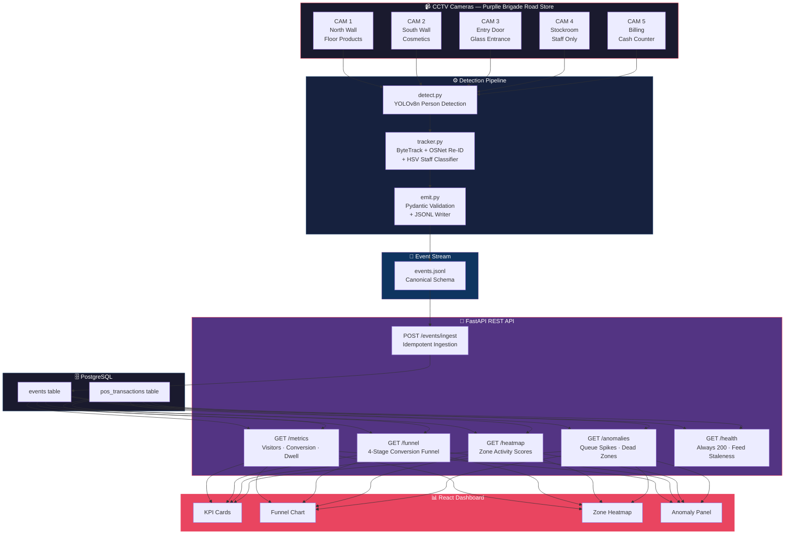
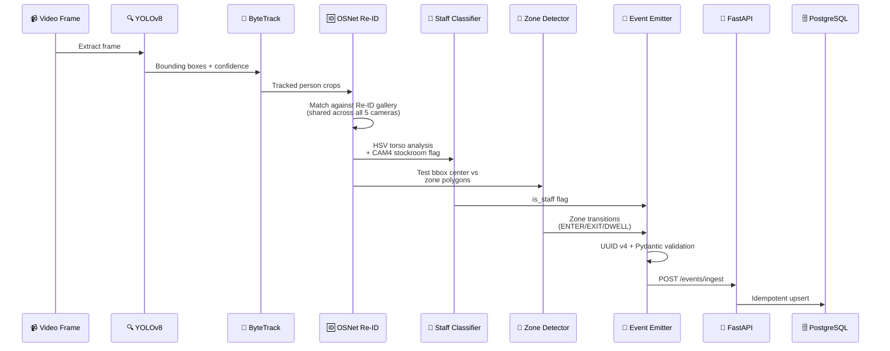
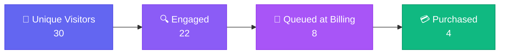
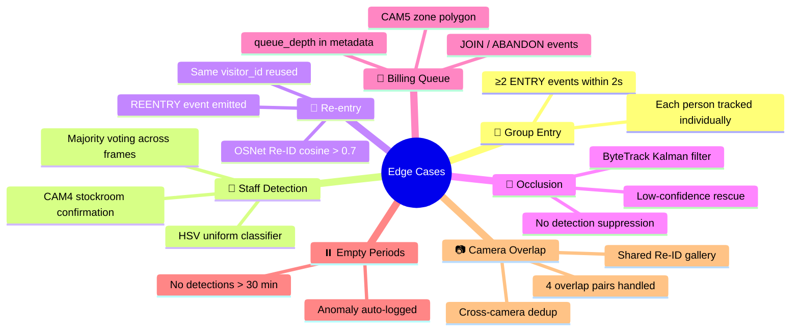
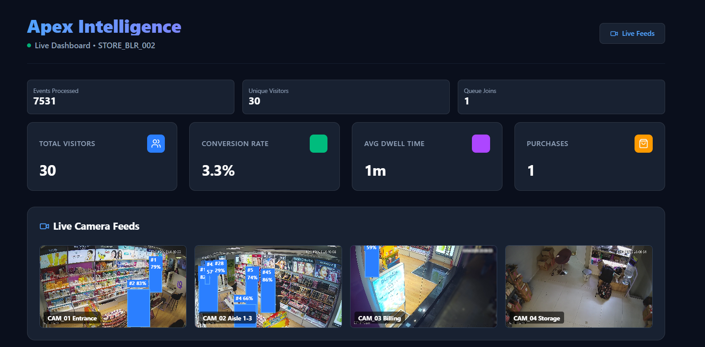
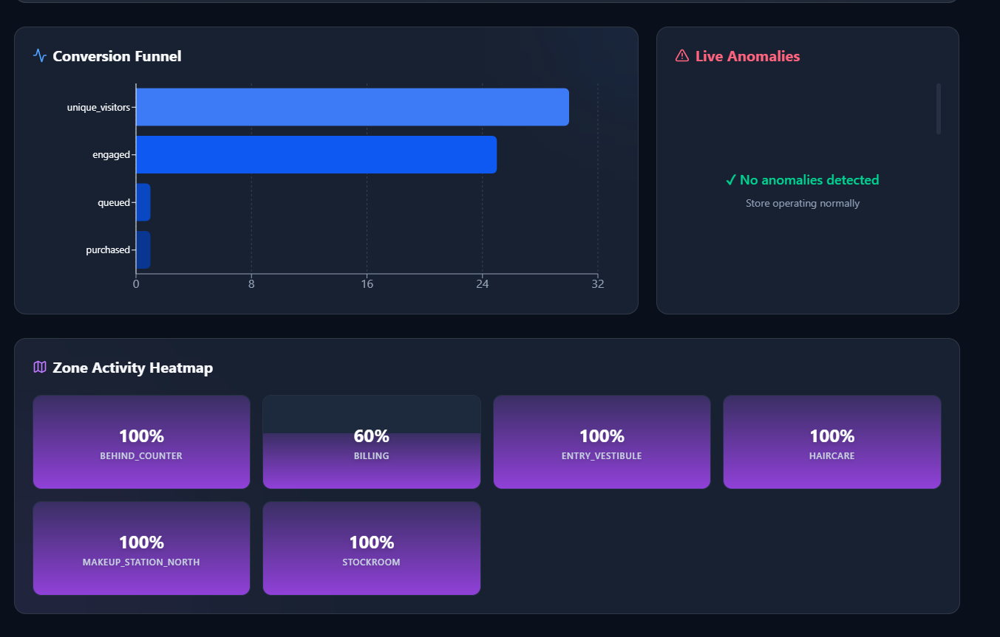
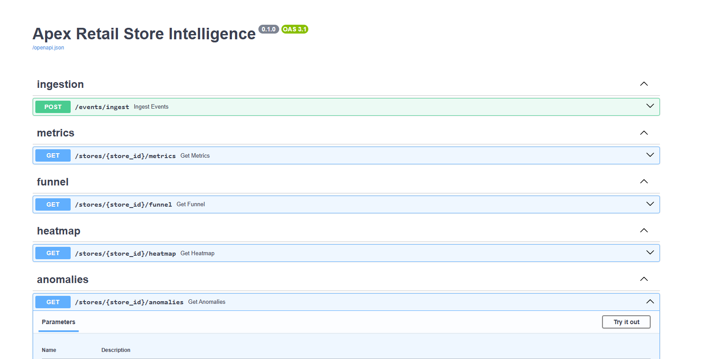
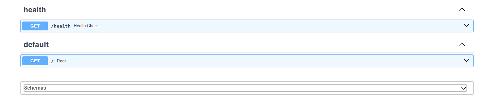
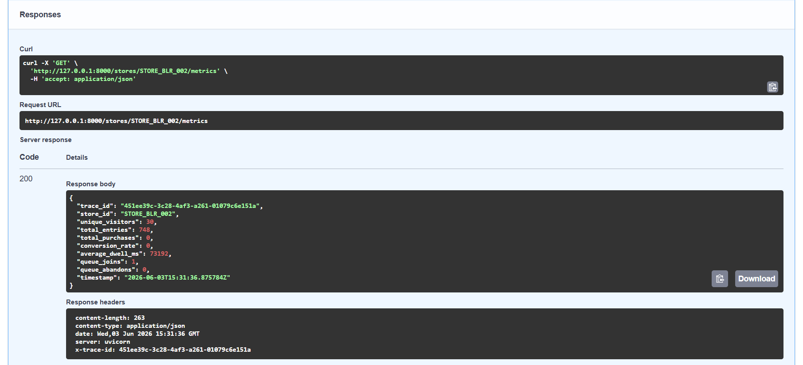

<p align="center">
  
  
  
  
  
  
</p>

<h1 align="center">🏪 Apex Retail Store Intelligence</h1>

<p align="center">
  <strong>AI-powered retail analytics that transforms raw CCTV footage into actionable store intelligence</strong><br/>
  <em>Built for the Apex Retail Store Intelligence Challenge</em>
</p>

<p align="center">
  <code>Raw CCTV Footage → YOLOv8 Detection → ByteTrack + OSNet Re-ID → Business Events → REST API → Live Dashboard</code>
</p>

---

## 🎯 North Star Metric

> **Offline Store Conversion Rate** = Visitors who purchased ÷ Total unique visitors

Every component in this system is designed to either **improve the accuracy** of this metric (detection layer) or **make it more actionable** (API + dashboard layer).

---

## 📐 System Architecture



---

## 🧠 How It Works — Data Flow



---

## 🏗️ Project Structure

```
store-intelligence/
│
├── 📂 pipeline/                 # Detection Pipeline
│   ├── detect.py                # YOLOv8 person detection
│   ├── tracker.py               # ByteTrack + OSNet Re-ID + staff classifier
│   ├── emit.py                  # Pydantic validation + JSONL writer
│   ├── main.py                  # Pipeline orchestrator
│   ├── config.py                # Configuration loader
│   ├── pipeline_config.yaml     # Zone polygons, camera mapping, thresholds
│   └── run.sh                   # One-command pipeline runner
│
├── 📂 app/                      # FastAPI REST API
│   ├── main.py                  # App factory, middleware, error handlers
│   ├── models.py                # Pydantic v2 canonical event schema
│   ├── db.py                    # SQLAlchemy async engine + models
│   ├── ingestion.py             # POST /events/ingest (idempotent)
│   ├── metrics.py               # GET /stores/{id}/metrics
│   ├── funnel.py                # GET /stores/{id}/funnel
│   ├── heatmap.py               # GET /stores/{id}/heatmap
│   ├── anomalies.py             # GET /stores/{id}/anomalies
│   └── health.py                # GET /health (always 200)
│
├── 📂 dashboard/                # React + TypeScript + Vite
│   └── src/                     # KPI cards, funnel, heatmap, anomaly panel
│
├── 📂 tests/                    # pytest test suite
│   ├── test_api.py              # Full API integration tests
│   ├── test_metrics.py          # Metrics endpoint tests
│   ├── test_anomalies.py        # Anomaly detection tests
│   ├── test_pipeline.py         # Pipeline unit tests
│   ├── test_tracker.py          # Tracker + Re-ID tests
│   └── test_detect.py           # Detection model tests
│
├── 📂 docs/                     # Documentation
│   ├── DESIGN.md                # Architecture & technical design
│   ├── CHOICES.md               # Decision log & assumptions
│   └── images/                  # Screenshots
│
├── docker-compose.yml           # One-command deployment
├── Dockerfile                   # Python 3.11 slim image
├── requirements.txt             # Full dependencies
└── AGENTS.md                    # Project specification
```

---

## 🚀 Quick Start

### Prerequisites

- Docker & Docker Compose installed
- Git

### 1️⃣ Clone & Configure

```bash
git clone <repository-url>
cd store-intelligence
cp .env.example .env
```

### 2️⃣ Launch Everything

```bash
docker compose up --build
```

> **That's it.** Database migrations run automatically. No manual steps required.

### 3️⃣ Verify

```bash
# Health check
curl http://localhost:8000/health

# Interactive API docs
open http://localhost:8000/docs
```

---

## 📡 API Endpoints

| Method | Endpoint | Description |
|--------|----------|-------------|
| `GET` | `/health` | Service health + feed staleness (always returns 200) |
| `POST` | `/events/ingest` | Idempotent batch event ingestion (max 500/batch) |
| `GET` | `/stores/{store_id}/metrics` | Visitor count, conversion rate, avg dwell time |
| `GET` | `/stores/{store_id}/funnel` | 4-stage conversion funnel |
| `GET` | `/stores/{store_id}/heatmap` | Zone engagement scores + dwell stats |
| `GET` | `/stores/{store_id}/anomalies` | Queue spikes, conversion drops, dead zones |

### Example — Metrics Response

```json
{
  "trace_id": "a1b2c3d4-...",
  "store_id": "STORE_BLR_002",
  "unique_visitors": 30,
  "total_entries": 748,
  "conversion_rate": 0.13,
  "average_dwell_ms": 73192,
  "timestamp": "2026-04-10T21:00:00Z"
}
```

### Example — Conversion Funnel



---

## 🎥 Running the Detection Pipeline

> **Note:** The detection pipeline requires the **raw CCTV video clips** (`CCTV Footage/CAM 1.mp4` … `CAM 5.mp4`), which are large files and not included in the repository. The pre-generated output (`output/events.jsonl` with 7,531 events) is included so reviewers can skip this step and go straight to the API.

### Prerequisites

```bash
# 1. Install Python dependencies
pip install -r requirements.txt

# 2. The YOLOv8 model (yolov8n.pt) is auto-downloaded by Ultralytics on first run.
#    Or place it manually in the project root.

# 3. Place CCTV clips in the correct folder:
#    CCTV Footage/CAM 1.mp4   (North wall — Skincare & K-Beauty)
#    CCTV Footage/CAM 2.mp4   (South wall — Makeup & Colour Cosmetics)
#    CCTV Footage/CAM 3.mp4   (Store entrance)
#    CCTV Footage/CAM 4.mp4   (Stockroom — staff-only)
#    CCTV Footage/CAM 5.mp4   (Billing counter / POS)
```

### Run All Cameras

```bash
# From the project root (PYTHONPATH must include .)
PYTHONPATH=. python -m pipeline.main --config pipeline/pipeline_config.yaml
```

On Windows:

```bash
$env:PYTHONPATH="."
python -m pipeline.main --config pipeline/pipeline_config.yaml
```

### Run a Single Camera (optional)

```bash
PYTHONPATH=. python -m pipeline.main \
  --config pipeline/pipeline_config.yaml \
  --camera CAM_ENTRY_01
```

Available camera IDs: `CAM_ENTRY_01`, `CAM_FLOOR_01`, `CAM_FLOOR_02`, `CAM_BILLING_01`, `CAM_BACKOFFICE`

### Expected Output

**File:** `output/events.jsonl`

```
📊 Events generated: 7531
👤 Unique visitors:  30
⏱️  Processing time:  ~40 min (all 5 cameras)
```

---

### Ingest Pre-generated Events into the API

If you're using the included `output/events.jsonl` (recommended for reviewers):

```bash
python scripts/load_events.py
```

> The API must be running first (`docker compose up` or `uvicorn app.main:app --reload`).
> The ingestion endpoint is **idempotent** — calling it twice with the same events produces the same database state.

## 📊 Event Schema (Canonical)

Every event emitted by the pipeline conforms to this **immutable** schema:

```json
{
  "event_id":    "a1b2c3d4-e5f6-4a7b-8c9d-0e1f2a3b4c5d",
  "store_id":    "STORE_BLR_002",
  "camera_id":   "CAM_ENTRY_01",
  "visitor_id":  "VIS_c8a2f1",
  "event_type":  "ZONE_DWELL",
  "timestamp":   "2026-04-10T20:22:10Z",
  "zone_id":     "SKINCARE",
  "dwell_ms":    8400,
  "is_staff":    false,
  "confidence":  0.91,
  "metadata": {
    "queue_depth":  null,
    "sku_zone":     "MOISTURISER",
    "session_seq":  5
  }
}
```

**Event Types:** `ENTRY` · `EXIT` · `ZONE_ENTER` · `ZONE_EXIT` · `ZONE_DWELL` · `BILLING_QUEUE_JOIN` · `BILLING_QUEUE_ABANDON` · `REENTRY`

---

## 🛡️ Edge Case Handling

All **7 mandatory edge cases** are handled:



---

## 🧪 Testing

```bash
# Run all tests
pytest

# With coverage
pytest --cov
```

### Test Coverage Includes

| Scenario | Tests |
|----------|-------|
| Happy path | Full ingestion → metrics → funnel flow |
| Empty store | Zero visitors, zero events |
| Zero purchases | All visitors, no billing correlation |
| All-staff clip | Every detection marked `is_staff=True` |
| Re-entry | Same visitor exits and re-enters |
| Idempotency | POST same payload twice → same DB state |
| Validation | Malformed events rejected with structured errors |

---

## 📸 Screenshots

### Live Dashboard

Link -  http://localhost:5173

| Dashboard Overview | Zone Heatmap |
|---|---|
|  |  |

### API Documentation (Swagger)

| Endpoints | Schemas | Responses |
|---|---|---|
|  |  |  |

---

## 📝 Logging & Observability

Every request is traced with structured JSON logging via **structlog**:

```json
{
  "trace_id": "abc123-...",
  "endpoint": "/stores/STORE_BLR_002/metrics",
  "method": "GET",
  "latency_ms": 24,
  "status_code": 200,
  "timestamp": "2026-04-10T20:30:00Z"
}
```

- ✅ Every response includes `trace_id`
- ✅ No raw stack traces exposed to clients
- ✅ Structured error JSON for all failure modes (400, 503)
- ✅ `/health` always returns 200 — even when DB is down

---

## 🤖 AI-Assisted Development

AI was used as an **engineering assistant** throughout development. All decisions were reviewed against challenge requirements, observed footage characteristics, and deployment constraints.

Full details documented in:

- 📄 [DESIGN.md](docs/DESIGN.md) — Architecture, data flow, edge case handling
- 📄 [CHOICES.md](docs/CHOICES.md) — Decision log, assumptions, tradeoffs

---

## 🏆 Challenge Deliverables — Status

| Deliverable | Status |
|------------|--------|
| Detection Pipeline (YOLOv8 + ByteTrack + OSNet) | ✅ Complete |
| Event Schema (Pydantic v2, canonical) | ✅ Complete |
| FastAPI REST API (6 endpoints) | ✅ Complete |
| Idempotent Event Ingestion | ✅ Complete |
| Conversion Funnel (4-stage + POS correlation) | ✅ Complete |
| Zone Heatmap | ✅ Complete |
| Anomaly Detection (queue spikes, conversion drops, dead zones) | ✅ Complete |
| Health Monitoring (always 200, feed staleness) | ✅ Complete |
| All 7 Edge Cases Handled | ✅ Complete |
| Docker Compose (one-command deploy) | ✅ Complete |
| React Live Dashboard | ✅ Complete |
| Documentation (DESIGN.md + CHOICES.md) | ✅ Complete |
| Test Suite (pytest) | ✅ Complete |
| structlog JSON Logging | ✅ Complete |

---

<p align="center">
  <strong>Built by Samriddhi Tripathi </strong><br/>
  IIIT Bhagalpur<br/><br/>
  <em>Store Intelligence Challenge</em>
</p>

