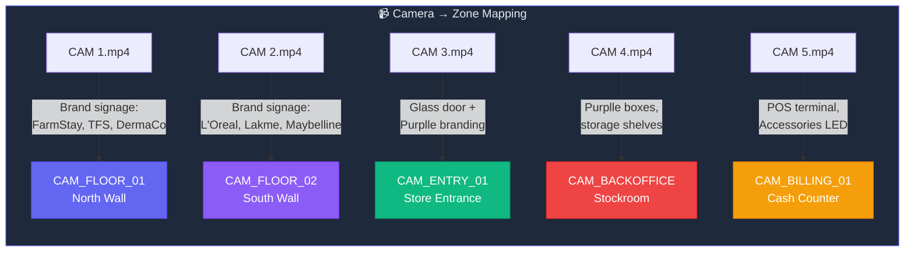
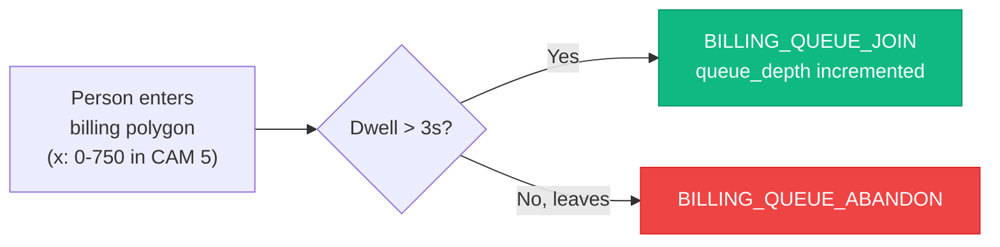
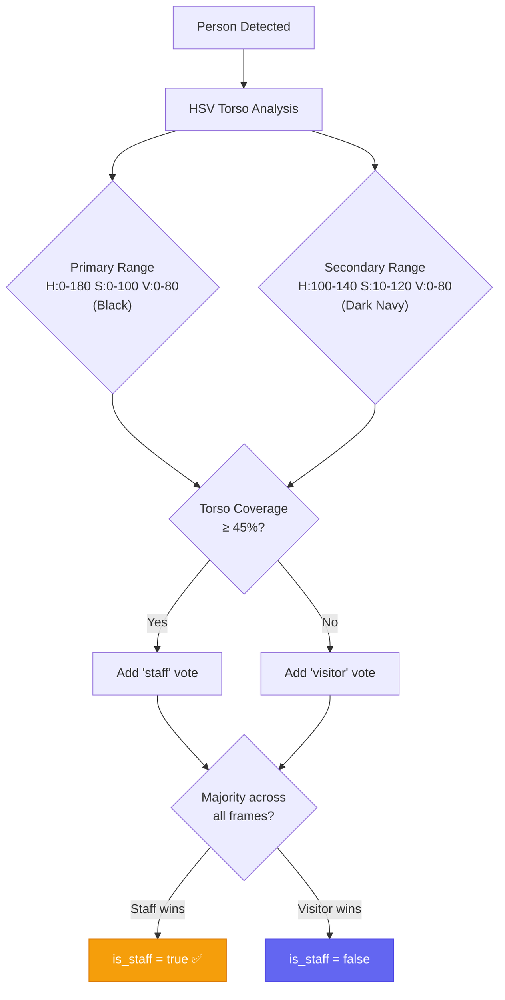
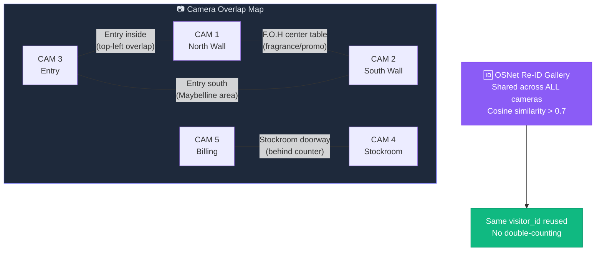
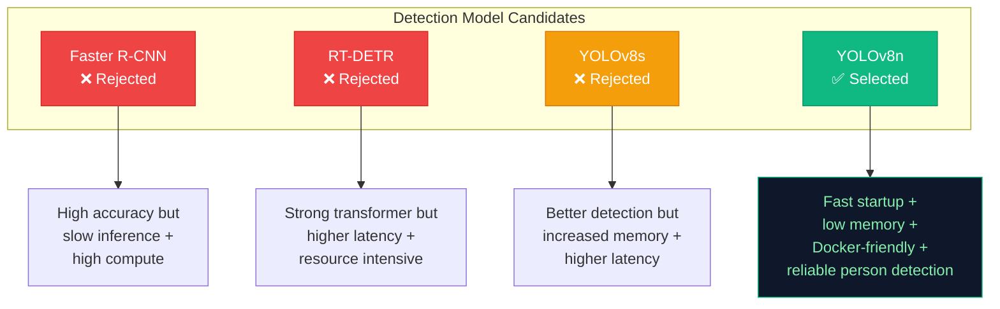
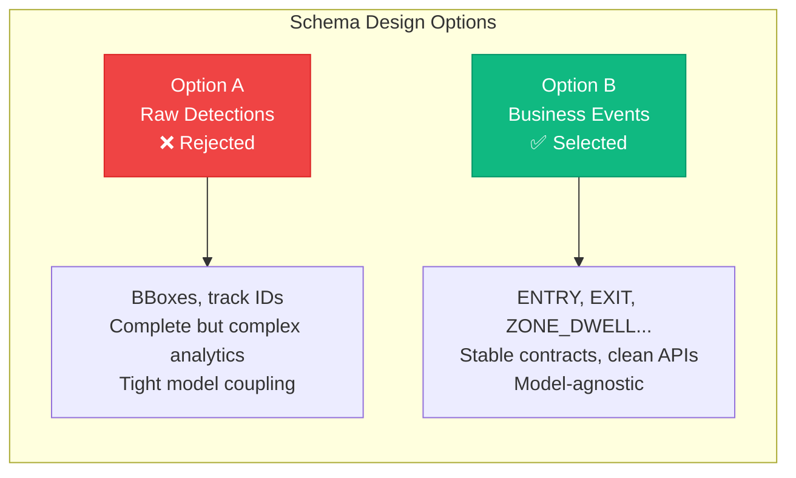
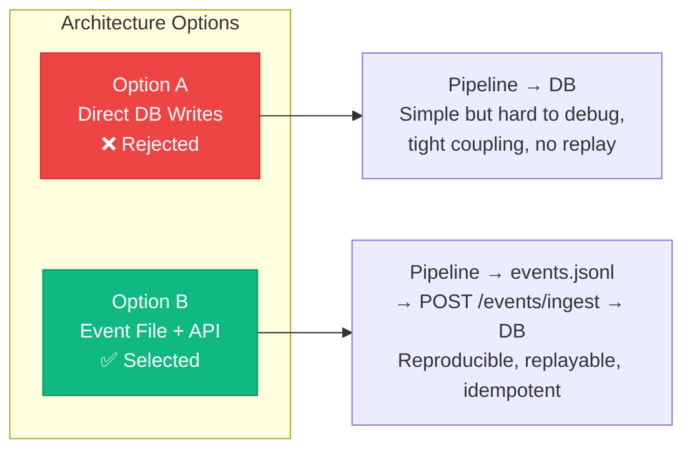
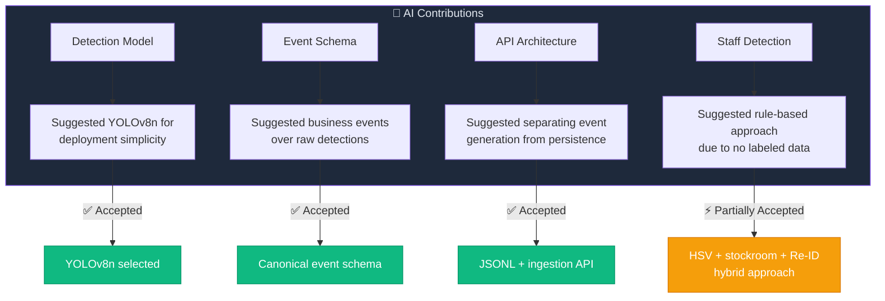

# 🧭 Design Decisions & Assumptions — CHOICES.md

This document records every major decision, assumption, and tradeoff made during the design and implementation of the Store Intelligence system. Each decision includes the context, options evaluated, final choice, and rationale.

---

## 📑 Table of Contents

| # | Decision | Category |
|---|----------|----------|
| 1–4 | [Camera Mapping & Clip Metadata](#-assumptions-derived-from-asset-analysis) | Asset Analysis |
| 5–8 | [Store Layout & Zones](#-store-layout-decisions) | Layout |
| 9–10 | [Staff Detection Strategy](#-staff-detection-decisions) | Staff |
| 11–12 | [Camera Overlap & Blind Spots](#-camera-overlap-decisions) | Overlap |
| 13–20 | [Technical Architecture](#-technical-decisions) | Architecture |
| 21 | [Detection Model Selection](#-decision-21-detection-model-selection) | Model |
| 22 | [Event Schema Design](#-decision-22-event-schema-design) | Schema |
| 23 | [API Architecture](#-decision-23-api-architecture) | API |
| — | [AI-Assisted Decisions](#-ai-assisted-decisions) | AI Usage |

---

## 📹 Assumptions Derived from Asset Analysis

### Decision 1 — Camera Mapping

Camera names (CAM 1–5) were **not labeled** in the footage metadata. Mapping was inferred from visible brand signage, fixtures, and comparison with the store layout diagram.

| File | Camera ID | Coverage | Identification Basis |
|------|-----------|----------|---------------------|
| `CAM 1.mp4` | `CAM_FLOOR_01` | North wall — FarmStay, TFS, Good Vibes, DermaCo, Minimalist, Aqualogica + fragrance table | Brands visible on shelf signage |
| `CAM 2.mp4` | `CAM_FLOOR_02` | South wall — Alps, L'Oréal, Swiss Beauty, Lakme, Faces Canada, Maybelline + nail/promo table | Brand signage confirmed in frame |
| `CAM 3.mp4` | `CAM_ENTRY_01` | Store entrance — glass door, Purplle backlit sign, entry mat, pavement | Glass door + Purplle branding; people enter from right |
| `CAM 4.mp4` | `CAM_BACKOFFICE` | Back office / stockroom — Purplle boxes, storage shelves, water dispenser | Staff-only area; no product shelves |
| `CAM 5.mp4` | `CAM_BILLING_01` | Cash counter — POS terminal, laptop, Accessories LED display | Cashier station clearly visible |

---

### Decision 2 — Clip Start Time

| Parameter | Value | Basis |
|-----------|-------|-------|
| **Start time** | `2026-04-10T20:10:00Z` | CCTV timestamps visible in frames show `10/04/2026 20:10:xx` |
| **Normalization** | All clips start at `20:10:00Z` | Exact seconds vary per camera (10:15, 10:18, 10:27, 10:32, 10:57) — normalized to common baseline |
| **Per-frame timestamp** | `clip_start_time + (frame_index / fps)` | ISO-8601 UTC as required by Detection Rules |

---

### Decision 3 — Frame Rate

> **Confirmed from video metadata** — not an assumption.

| Camera | FPS | Source |
|--------|-----|--------|
| CAM 1, 2, 3 | **30.0** | OpenCV `cv2.CAP_PROP_FPS` |
| CAM 4, 5 | **25.0** | OpenCV `cv2.CAP_PROP_FPS` |

---

### Decision 4 — Resolution

> **Confirmed**: All cameras are **1920×1080** (Full HD). Zone polygons are defined in this coordinate space.

---

## 🏪 Store Layout Decisions

### Decision 5 — Entry/Exit Point

| Aspect | Decision |
|--------|----------|
| **Configuration** | Single entry/exit via glass door on left wall (CAM 3) |
| **Basis** | Store layout shows "Existing Glass" on left with curved entry. "Access" area (bottom-right) is staff-only |
| **Entry direction** | Right-to-left in CAM 3 frame (outside pavement → glass door → store interior) |

---

### Decision 6 — Zone Polygon Coordinates

**Assumption:** Zone polygons are approximated from the 1920×1080 CCTV frames. Estimated by identifying brand signage boundaries, fixture positions, and shelf edges. May need refinement after a test run.

---

### Decision 7 — Billing Counter Location

| Aspect | Decision |
|--------|----------|
| **Camera** | CAM 5 (`CAM_BILLING_01`) |
| **Basis** | Frame shows POS terminal, laptop, counter desk, staff member in black operating cash register |
| **Layout match** | "CASH COUNTER" label on store layout (far right side) |

---

### Decision 8 — Queue Detection

| Aspect | Decision |
|--------|----------|
| **Detection zone** | Customer-facing side of billing counter (left half of CAM 5, x: 0–750) |
| **Queue boundary** | Counter creates natural boundary; customers approach from store floor (left) |
| **Limitation** | No dedicated queue rope visible; queue depth estimated as simultaneous person count inside billing zone |

---

## 👔 Staff Detection Decisions

### Decision 9 — Staff Uniform Color: Black

| Aspect | Decision |
|--------|----------|
| **Method** | HSV color analysis on torso crop |
| **Evidence** | CAM 5 cashier: all-black top/pants. CAM 4 stockroom: dark clothing. CAM 1/2: staff in black near counters |
| **Mitigation** | Majority voting across multiple frames — brief visitors in black won't accumulate enough "staff" votes |
| **Known limitation** | Black is a common visitor color → false positives possible, mitigated by voting |

---

### Decision 10 — CAM 4 as Staff Identifier

| Aspect | Decision |
|--------|----------|
| **Rule** | All persons detected in CAM 4 (`CAM_BACKOFFICE`) are definitively staff |
| **Basis** | Stockroom is clearly staff-only (boxes, storage, no product display) |
| **Propagation** | Combined with Re-ID gallery matching → anyone seen here and later on floor is tagged `is_staff = True` |

---

## 📷 Camera Overlap Decisions

### Decision 11 — Overlap Regions

---

### Decision 12 — Known Blind Spots

| Location | Impact | Mitigation |
|----------|--------|------------|
| Far-left corner of north wall (FarmStay edge) | Partial coverage — persons at shelf edge may be partially occluded | ByteTrack Kalman filter predicts through brief occlusion |
| Behind F.O.H makeup unit chairs | Area between chairs hidden from both floor cameras | Accepted — short transit zone, not a dwell area |
| Passage between billing and stockroom | Brief tracking loss during CAM 5 → CAM 4 handoff | Re-ID gallery re-matches on reappearance |

---

## ⚙️ Technical Decisions

### Decision 13 — ByteTrack over BoTSORT

| Aspect | Detail |
|--------|--------|
| **Choice** | ByteTrack (specified in AGENTS.md) |
| **Why** | Excels at handling occlusion by associating **both** high- and low-confidence detections |
| **Critical for** | Dense retail environment with shelving fixtures causing frequent partial occlusion (Edge Case #4) |

---

### Decision 14 — OSNet Re-ID Model

| Aspect | Detail |
|--------|--------|
| **Choice** | `osnet_x1_0` (specified in AGENTS.md) |
| **Why** | 512-dimensional embeddings with good cross-domain generalization |
| **Alternative considered** | `osnet_ain` for domain generalization — standard model performs adequately for single-store |

---

### Decision 15 — HSV over Deep Learning Staff Classification

| Aspect | Detail |
|--------|--------|
| **Choice** | HSV uniform color analysis + majority voting |
| **Why** | No labeled staff training data available; deployable immediately |
| **Supplement** | CAM 4 stockroom provides ground truth for Re-ID-based staff ID |

---

### Decision 16 — Confidence Threshold = 0.0

> **Hard Rule #4:** *"Never suppress low-confidence detections — emit with real confidence value."*

| Aspect | Detail |
|--------|--------|
| **Choice** | Emit ALL detections with raw confidence |
| **Filtering** | Happens at query time in the API layer, never at emission time |

---

### Decision 17 — JSONL Event Emission (not direct API POST)

| Aspect | Detail |
|--------|--------|
| **Choice** | Pipeline writes to `events.jsonl`; API ingestion is a separate step |
| **Basis** | Specified in build-pipeline workflow |
| **Benefits** | Reliability, debuggability, replayability |
| **Future** | Config includes `emit_to_api` flag for direct API posting |

---

### Decision 18 — Session Sequence Numbering

| Aspect | Detail |
|--------|--------|
| **Choice** | `session_seq` is a monotonic counter per `visitor_id`, incremented on each event |
| **Interpretation** | AGENTS.md schema shows `session_seq: 5` → "the 5th event in this visitor's session" |
| **Scope** | Resets across pipeline runs |

---

### Decision 19 — Store Hours & Empty Period Detection

| Aspect | Detail |
|--------|--------|
| **Assumption** | Footage is from 8:10 PM — store operates in evening hours |
| **Threshold** | 30 minutes with no detections → anomaly logged |
| **Note** | May need adjustment based on actual operating hours |

---

### Decision 20 — Entry Direction

| Aspect | Detail |
|--------|--------|
| **Direction** | Right → Left in CAM 3 (outside → inside) |
| **Basis** | Outside pavement is on right, glass door center, store interior left |

---

## 🔍 Decision 21 — Detection Model Selection

### Problem

Detect people reliably across 5 CCTV cameras while remaining deployable on commodity hardware inside Docker containers.

### Options Evaluated

### Final Choice: **YOLOv8n**

| Factor | YOLOv8n |
|--------|---------|
| Inference speed | ⚡ Fastest |
| Memory usage | 🟢 Lowest |
| Person detection | ✅ Reliable for medium-to-large instances |
| Docker deployment | ✅ Lightweight image |
| Tradeoff | Slightly lower accuracy vs YOLOv8s — not justified for this scenario |

---

## 📋 Decision 22 — Event Schema Design

### Problem

Raw detections (bounding boxes, track IDs) are difficult to use for business analytics. The API must answer: *How many visited? How many purchased? Which zones get attention? Where do customers drop off?*

### Options Evaluated

### Final Choice: **Business Event Schema**

The challenge evaluates **retail intelligence**, not computer vision metrics. Business events create a clean abstraction between detection, tracking, analytics, and dashboard visualization — and allow future model changes without affecting API consumers.

---

## 🏗️ Decision 23 — API Architecture

### Problem

How should events flow from the detection pipeline into analytics services?

### Options Evaluated

### Final Choice: **Pipeline → events.jsonl → Ingestion API → Database**

| Benefit | Description |
|---------|-------------|
| **Observability** | Human-readable event file for debugging |
| **Replayability** | Re-ingest without rerunning the pipeline |
| **Idempotency** | POST same payload twice → same DB state |
| **Decoupling** | Detection pipeline independent from storage |

---

## 🤖 AI-Assisted Decisions

AI was used as an **engineering assistant** throughout development. The objective was not to blindly follow suggestions, but to accelerate exploration of architectures and implementation strategies.

| Decision | AI Suggestion | Outcome | Rationale |
|----------|--------------|---------|-----------|
| **Detection model** | YOLOv8n | ✅ Accepted | Best speed/accuracy tradeoff for Docker deployment |
| **Event schema** | Business-level events | ✅ Accepted | Cleaner analytics, stable API contracts |
| **API architecture** | Separate generation & persistence | ✅ Accepted | Replayability, easier debugging |
| **Staff detection** | Lightweight rule-based approach | ⚡ Partially accepted | Extended with stockroom confirmation + Re-ID propagation |

> **Reflection:** AI accelerated implementation and architectural exploration, but all final decisions were reviewed against challenge requirements, observed footage characteristics, deployment constraints, and expected business outcomes.

---

## 🏁 Final Architecture Summary

The architecture prioritizes **simplicity**, **reproducibility**, **operational visibility**, and **business value** while remaining practical to deploy within the challenge constraints.
