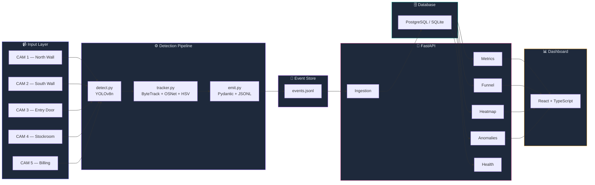
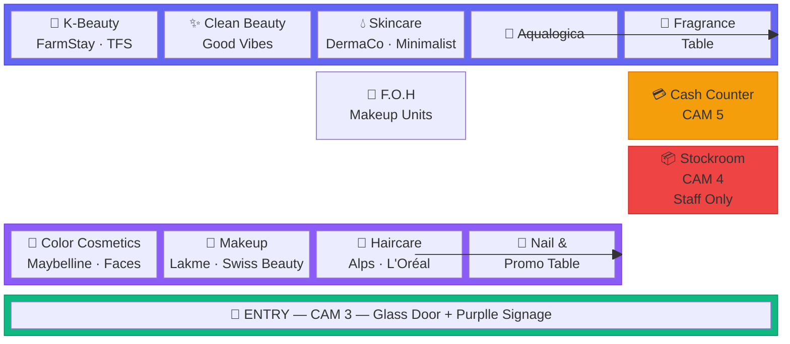
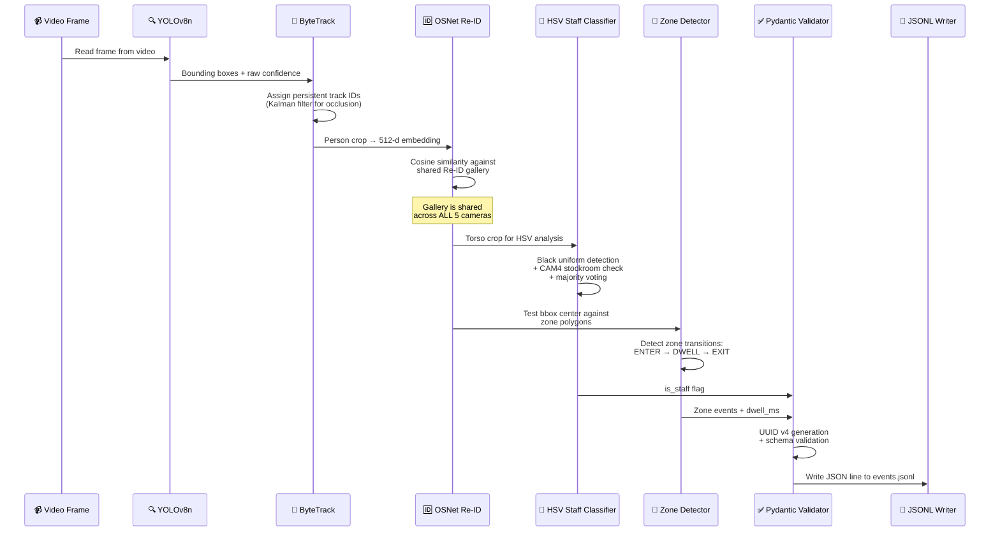
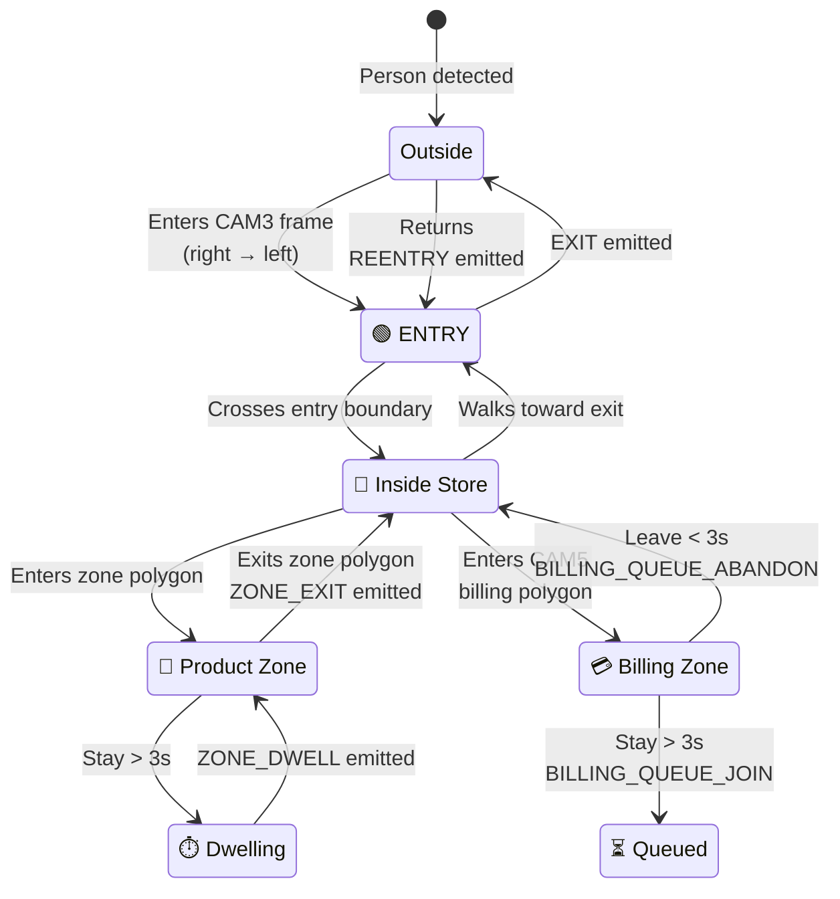
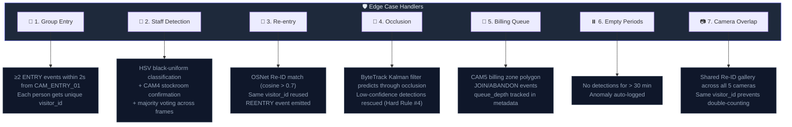
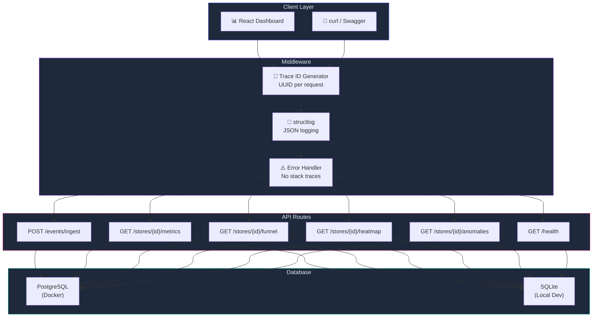
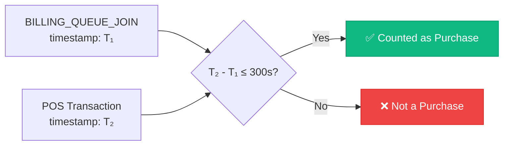
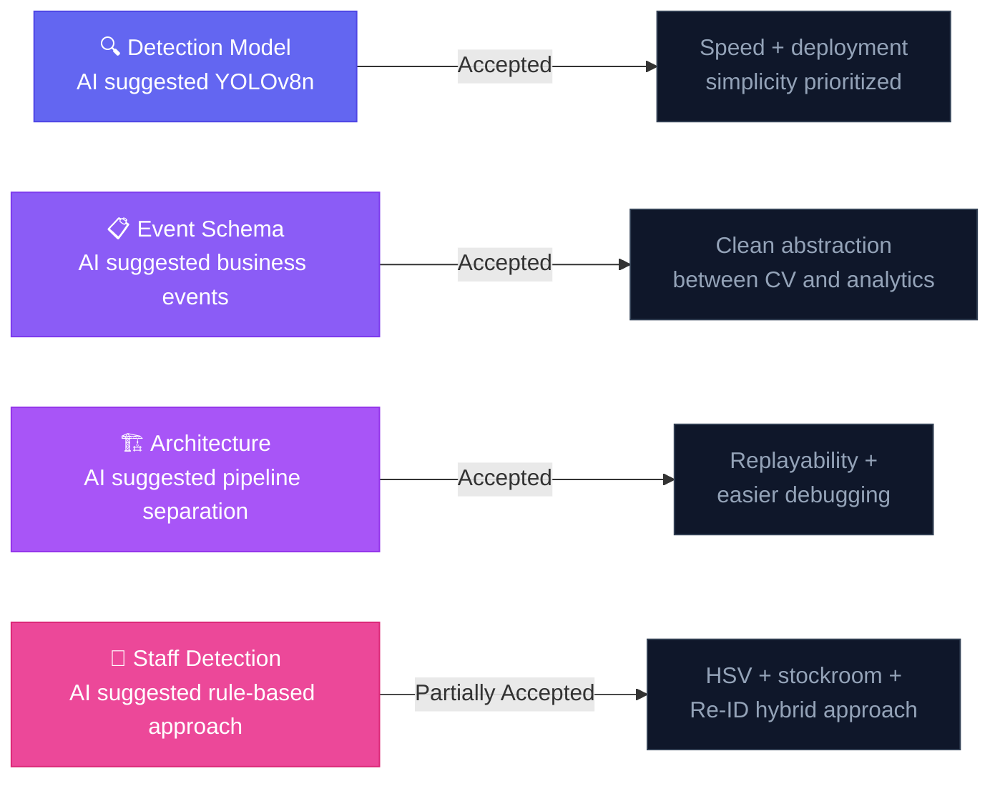
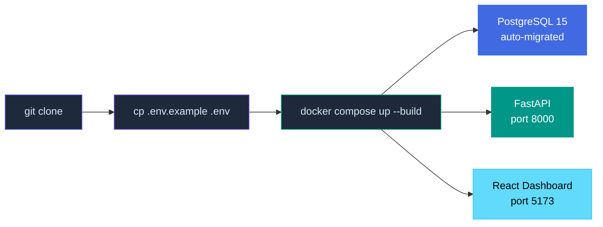

# 🏗️ Architecture & Technical Design — DESIGN.md

## 📐 System Overview

The system follows a **pipeline → event file → API → dashboard** architecture, cleanly separating computer vision from analytics.

---

## 📹 Camera Coverage Map

The store has **5 CCTV cameras** covering all customer-facing areas plus the staff stockroom:

| Camera | ID | Coverage | FPS | Resolution |
|--------|----|----------|-----|------------|
| CAM 1 | `CAM_FLOOR_01` | North wall — FarmStay, TFS, Good Vibes, DermaCo, Minimalist, Aqualogica | 30 | 1920×1080 |
| CAM 2 | `CAM_FLOOR_02` | South wall — Maybelline, Faces, Lakme, Swiss Beauty, Alps, L'Oréal | 30 | 1920×1080 |
| CAM 3 | `CAM_ENTRY_01` | Store entrance — glass door, Purplle sign, entry mat | 30 | 1920×1080 |
| CAM 4 | `CAM_BACKOFFICE` | Stockroom — staff-only area, storage shelves | 25 | 1920×1080 |
| CAM 5 | `CAM_BILLING_01` | Cash counter — POS terminal, accessories display | 25 | 1920×1080 |

---

## 🔄 Per-Frame Data Flow

Every video frame goes through this processing chain:

---

## 📍 Zone Detection Logic

| Zone Type | Events Generated | Trigger Condition |
|-----------|-----------------|-------------------|
| `entry_exit` | `ENTRY`, `EXIT`, `REENTRY` | Person crosses entry zone boundary in CAM 3 |
| `dwell` | `ZONE_ENTER`, `ZONE_EXIT`, `ZONE_DWELL` | Person enters/exits zone polygon; `DWELL` if stay > 3s |
| `billing` | `BILLING_QUEUE_JOIN`, `BILLING_QUEUE_ABANDON` | Person enters billing zone in CAM 5; `ABANDON` if leave < 3s |
| `staff_only` | *(staff flag)* | All persons detected in CAM 4 → `is_staff = True` via Re-ID propagation |

---

## 🛡️ Edge Case Handling — All 7 Covered

### Camera Overlap Pairs

| Pair | Overlap Region | Description |
|------|---------------|-------------|
| CAM 1 ↔ CAM 2 | F.O.H center | Fragrance/promo table visible from both floor cameras |
| CAM 5 ↔ CAM 4 | Stockroom doorway | Doorway behind cash counter leads to stockroom |
| CAM 3 ↔ CAM 1 | Entry inside | Top-left of CAM 3 overlaps left edge of CAM 1 |
| CAM 3 ↔ CAM 2 | Entry south | Entry area near Maybelline section, partially in CAM 2 |

> **Resolution:** The OSNet Re-ID gallery is **shared across all cameras**. When a person is detected in CAM 1 and then appears in CAM 2, cosine similarity > 0.7 matches them to the same `visitor_id`. No double-counting occurs.

---

## 🚀 API Architecture

### Key Design Decisions

| Decision | Choice | Rationale |
|----------|--------|-----------|
| Error responses | Structured JSON, never 500 | Hard Rule #7 — no raw stack traces |
| `/health` | Always returns 200 | Hard Rule #6 — even when DB is down, status shows `db: "down"` |
| Ingestion | Idempotent by `event_id` | Hard Rule #5 — POST same payload twice → same DB state |
| Validation | Pydantic v2 | Hard Rule #1 — every event validated against canonical schema |
| Tracing | UUID per request | Every response includes `trace_id` for observability |

---

## 💳 POS Correlation Rule

> A session counts as a **purchase** if the visitor had a billing-zone event within **5 minutes before** a POS transaction timestamp for the same `store_id`.

---

## 🤖 AI-Assisted Decisions

AI was used as an **engineering assistant** during design and implementation. The objective was to accelerate architectural exploration — not to blindly follow suggestions.

### Summary of AI Contributions

> **Reflection:** AI accelerated implementation and architectural exploration, but all final decisions were reviewed against challenge requirements, observed footage characteristics, deployment constraints, and expected business outcomes.

---

## 🐳 Deployment

**Zero manual steps after `git clone`.** Database migrations run automatically on container start. No hardcoded ports — all read from environment variables.
